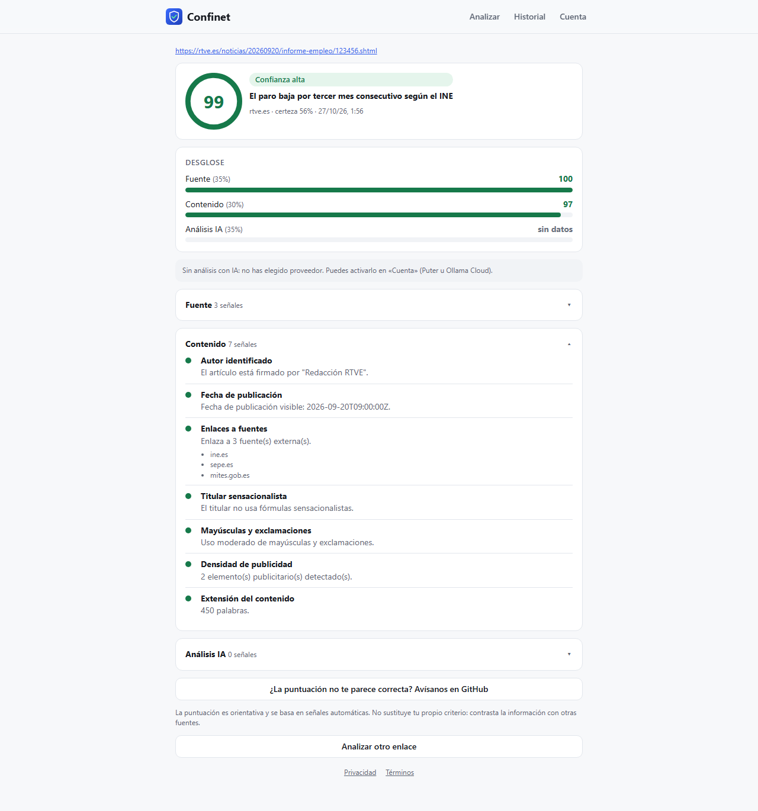
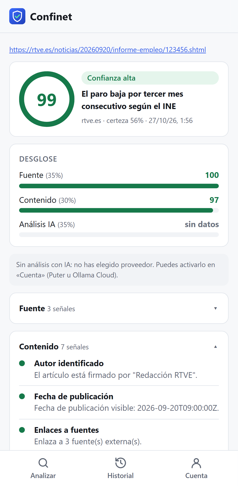
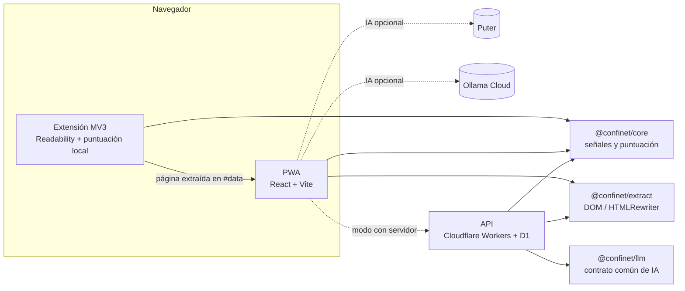

<div align="center">


# Confinet

**¿Te puedes fiar de lo que estás leyendo?**

Extensión de navegador + app (PWA) que mide la confianza de la información en internet:
fuente, contenido y análisis con IA, **explicados señal a señal**.

[](https://github.com/ahiram1701/confinet/actions/workflows/ci.yml)
[](https://github.com/ahiram1701/confinet/actions/workflows/pages.yml)
[](https://github.com/ahiram1701/confinet/actions/workflows/codeql.yml)
[](LICENSE)


[**Probar la app →**](https://ahiram1701.github.io/confinet/) ·
[Guía de uso](docs/guia-de-uso.md) ·
[Descargar la extensión](https://github.com/ahiram1701/confinet/releases) ·
[Informar de un problema](https://github.com/ahiram1701/confinet/issues/new/choose)

</div>

<p align="center">
  
  &nbsp;
  
</p>

## Primeros pasos

1. **Abre la app**: <https://ahiram1701.github.io/confinet/> e instálala en tu móvil u ordenador
   si quieres.
2. **Instala la extensión** (Chrome, Edge, Brave) desde
   [Releases](https://github.com/ahiram1701/confinet/releases).
   [Instrucciones paso a paso](docs/guia-de-uso.md#3-instalar-la-extensión).
3. **Analiza**: pulsa el icono de Confinet en cualquier noticia, o pega o comparte un enlace en la
   app.
4. **Opcional**: activa la IA en **Cuenta** con [Puter](https://puter.com) (gratis) u
   [Ollama Cloud](https://ollama.com) (tu API key).

📖 La **[guía de uso completa](docs/guia-de-uso.md)** explica cada pantalla, cómo leer el
resultado, la privacidad y la solución de problemas.

## Características

- 🧮 **Puntuación 0–100 explicada**: cada señal dice qué se midió y por qué suma o resta.
- 🎯 **Grado de certeza**: indica cuánto se pudo medir; sin datos suficientes, no hay nota.
- 🧩 **Extensión de navegador** (Manifest V3) con estimación instantánea y permisos mínimos.
- 📱 **App instalable (PWA)** con «Compartir → Confinet» en Android.
- 🤖 **IA opcional y a tu elección**: ningún proveedor ni modelo por defecto. Puter (Claude, GPT,
  Gemini…), Ollama Cloud o, en la versión con servidor, cualquier proveedor (Anthropic, OpenAI,
  Gemini, Mistral, Groq, OpenRouter, Workers AI, Ollama, endpoints compatibles con OpenAI).
- 🔒 **Privacidad primero**: en la versión publicada no hay servidor propio; el historial y tus
  claves se quedan en tu navegador.
- 💸 **Coste 0 €** para publicarlo: GitHub Pages + GitHub Actions.

## Cómo se calcula la puntuación

| Pilar           | Peso | Señales                                                                                                              |
| --------------- | ---- | -------------------------------------------------------------------------------------------------------------------- |
| **Fuente**      | 35%  | Reputación del medio, antigüedad del dominio (RDAP), HTTPS, páginas «Quiénes somos» y «Contacto»                     |
| **Contenido**   | 30%  | Autor, fecha, enlaces a fuentes externas, titular sensacionalista, mayúsculas y exclamaciones, publicidad, extensión |
| **Análisis IA** | 35%  | Tono, falacias, afirmaciones verificables con o sin fuente, valoración general                                       |

- Si un pilar no está disponible, su peso se **reparte** entre los demás y baja la **certeza**.
- Ciertas señales **limitan** la nota: un medio señalado como poco fiable no supera 45, y un
  desmentido de un verificador no supera 35.
- Niveles: 🟢 alta (≥70) · 🟠 media (45–69) · 🔴 baja (<45) · ⚪ sin datos (certeza <25%).

## Arquitectura



El monorepo (pnpm + Turborepo) comparte el mismo motor en todas las piezas:

```
packages/
  core/       Motor de puntuación puro: señales, pesos, agregación, tipos y traspaso extensión→PWA
  extract/    Extracción del artículo: Readability (navegador) y HTMLRewriter (Workers)
  llm/        Capa de IA agnóstica de proveedor (AI SDK + esquema Zod común)
  ui/         Componentes React compartidos (medidor, desglose, señales)
apps/
  web/        PWA: backend «estático» (en el navegador) o «api» (Cloudflare)
  extension/  Extensión MV3 (WXT + React)
  api/        Hono en Cloudflare Workers + D1 (Drizzle) + Better Auth
docs/         Guía de uso y capturas
```

## Modos de despliegue

|                                    | **Sin servidor** (publicado)                   | **Con servidor** (opcional)                                    |
| ---------------------------------- | ---------------------------------------------- | -------------------------------------------------------------- |
| Alojamiento                        | GitHub Pages                                   | Cloudflare Pages + Workers + D1                                |
| Análisis                           | En el navegador                                | En la API                                                      |
| Descarga de enlaces pegados        | Puter (o la extensión)                         | El servidor                                                    |
| Cuentas e historial                | Historial local                                | Cuentas OAuth e historial sincronizado                         |
| IA                                 | Puter u Ollama Cloud, elegida por cada usuario | Cualquier proveedor (configuración + clave propia por usuario) |
| Verificaciones (Google Fact Check) | —                                              | ✓                                                              |
| Panel de administración            | —                                              | ✓                                                              |
| Coste                              | 0 €                                            | 0 € con los planes gratuitos de Cloudflare                     |

El modo se elige al compilar: `pnpm --filter @confinet/web build:static` (GitHub Pages) o
`pnpm --filter @confinet/web build` (con API).

### Costes de la IA

| Proveedor             | Quién paga                                                                     |
| --------------------- | ------------------------------------------------------------------------------ |
| Ninguno (por defecto) | Nadie: solo heurísticas                                                        |
| Puter                 | Cada usuario, con su cuenta de Puter («paga el usuario»); 0 € para el proyecto |
| Ollama Cloud          | Quien pone la API key, por token ([precios](https://ollama.com/pricing))       |

## Desarrollo

Requisitos: **Node 22+** y **pnpm 10**.

```bash
pnpm install
```

### Versión sin servidor (como en GitHub Pages)

```bash
pnpm --filter @confinet/web build:static
```

```bash
pnpm --filter @confinet/web exec vite preview --base /confinet/
```

### Versión con servidor (API local en Workers)

```bash
cp apps/api/.dev.vars.example apps/api/.dev.vars
```

Rellena `BETTER_AUTH_SECRET` y `ENCRYPTION_KEY` (`openssl rand -base64 32`). En local la IA usa
el proveedor simulado `mock`; para uno real define `LLM_PROVIDER` y `LLM_MODEL` (obligatorio, no
hay modelos por defecto).

```bash
pnpm --filter @confinet/api db:migrate:local
```

```bash
pnpm dev
```

- PWA: <http://localhost:5173> · API: <http://localhost:8788/api/health>

### Extensión

```bash
pnpm --filter @confinet/extension dev
```

Compílala para la versión publicada con `WXT_BACKEND=static` y
`WXT_APP_URL=https://ahiram1701.github.io/confinet`. La versión del manifest se puede forzar con
`WXT_VERSION` (la CI la calcula sola en cada release).

### Tests

```bash
pnpm turbo run lint typecheck test
```

```bash
pnpm --filter @confinet/web e2e
```

```bash
pnpm --filter @confinet/web e2e:static
```

Hay tests unitarios del motor, la extracción, la capa de IA (con modelos simulados), la API
(dentro del runtime real de Workers: análisis, caché, cuotas, protección SSRF, autenticación,
BYOK) y E2E con Playwright de ambos modos, en móvil y escritorio.

## CI/CD

| Workflow                                                           | Cuándo                              | Qué hace                                                                                                    |
| ------------------------------------------------------------------ | ----------------------------------- | ----------------------------------------------------------------------------------------------------------- |
| [`ci.yml`](.github/workflows/ci.yml)                               | PR y push a `main`                  | Formato, lint, tipos, tests, builds y E2E de ambos modos                                                    |
| [`pages.yml`](.github/workflows/pages.yml)                         | Push a `main`                       | Publica la PWA en GitHub Pages                                                                              |
| [`release-extension.yml`](.github/workflows/release-extension.yml) | Push a `main` que toca la extensión | Versión nueva automática (tag `ext-v*` + Release con el `.zip`); Edge Add-ons y Chrome Web Store opcionales |
| [`deploy.yml`](.github/workflows/deploy.yml)                       | Push a `main` / tag `v*`            | Cloudflare (desactivado hasta definir `CLOUDFLARE_ENABLED=true`)                                            |
| [`codeql.yml`](.github/workflows/codeql.yml)                       | PR, push y semanal                  | Análisis de seguridad                                                                                       |

Para activar el modo con servidor en Cloudflare, sigue [docs/despliegue-cloudflare.md](docs/despliegue-cloudflare.md).

Los pasos que requieren las cuentas del mantenedor (probar la IA con Puter u Ollama, publicar en
Edge Add-ons o Chrome Web Store) están en [docs/pasos-pendientes.md](docs/pasos-pendientes.md).

## Roadmap

- [ ] Publicación en Edge Add-ons
- [ ] Ampliar la base de reputación con listas abiertas de licencia compatible
- [ ] Verificaciones externas en el modo sin servidor
- [ ] Traducción de la interfaz (inglés)

## Contribuir

¡Las contribuciones son bienvenidas! Lee [CONTRIBUTING.md](CONTRIBUTING.md) y el
[código de conducta](CODE_OF_CONDUCT.md). Para vulnerabilidades, consulta [SECURITY.md](SECURITY.md).

## Licencia

[MIT](LICENSE) © 2026 Alberto Hiram Saucedo Guajardo.

> Las puntuaciones de Confinet son orientativas y automáticas. No sustituyen el criterio propio
> ni la verificación profesional.
