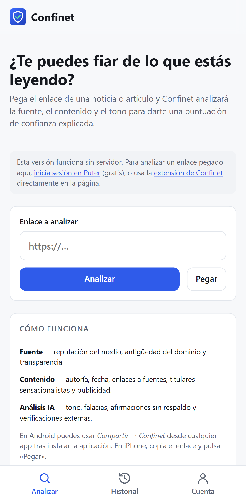
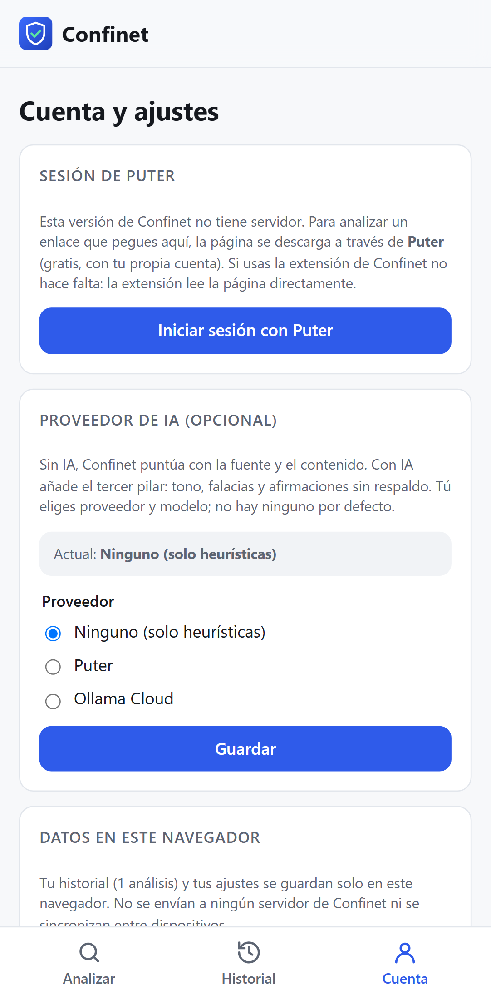
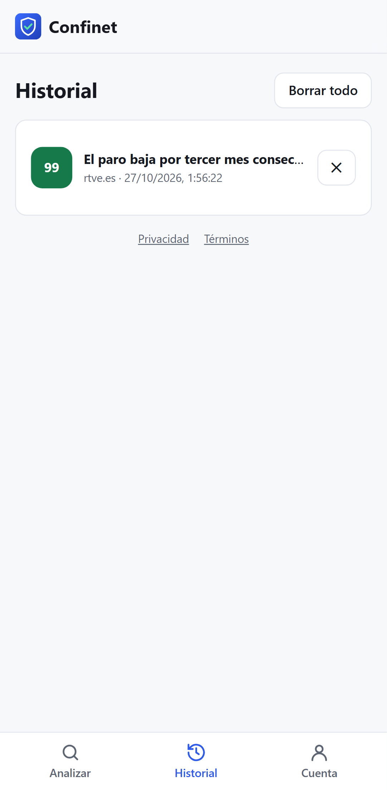

# Guía de uso de Confinet

Esta guía explica, paso a paso, cómo usar Confinet para saber cuánto puedes fiarte de lo que lees
en internet.

**Índice**

1. [Qué es (y qué no es) Confinet](#1-qué-es-y-qué-no-es-confinet)
2. [Instalar la app](#2-instalar-la-app)
3. [Instalar la extensión](#3-instalar-la-extensión)
4. [Analizar una página](#4-analizar-una-página)
5. [Entender el resultado](#5-entender-el-resultado)
6. [Activar el análisis con IA (opcional)](#6-activar-el-análisis-con-ia-opcional)
7. [Historial](#7-historial)
8. [Análisis automático de la extensión](#8-análisis-automático-de-la-extensión)
9. [Informar de una puntuación incorrecta](#9-informar-de-una-puntuación-incorrecta)
10. [Privacidad: qué sale de tu navegador](#10-privacidad-qué-sale-de-tu-navegador)
11. [Preguntas frecuentes y solución de problemas](#11-preguntas-frecuentes-y-solución-de-problemas)
12. [Para desarrolladores](#12-para-desarrolladores)

---

## 1. Qué es (y qué no es) Confinet

Confinet analiza una noticia o un artículo y te da una **puntuación de confianza de 0 a 100**,
explicada señal a señal: quién publica, cómo está escrito y, si lo activas, qué opina un modelo de
IA sobre el tono y los argumentos.

- ✅ Es una **ayuda orientativa** para leer con espíritu crítico.
- ✅ Te dice **por qué** da cada puntuación, para que puedas juzgar tú.
- ❌ **No es un verificador de hechos**: no dice si algo es verdad o mentira.
- ❌ No juzga opiniones ni ideologías: valora el método (fuentes, autoría, tono), no la postura.

Hay dos formas de usarlo, y se complementan:

|          | **App (PWA)**                                  | **Extensión del navegador**           |
| -------- | ---------------------------------------------- | ------------------------------------- |
| Dónde    | Móvil y escritorio                             | Chrome, Edge, Brave (escritorio)      |
| Cómo     | Pegas o compartes un enlace                    | Pulsas el icono en la página que lees |
| Necesita | Sesión de Puter para descargar enlaces pegados | Nada más                              |

---

## 2. Instalar la app

La app es una **PWA**: una web que se instala como una aplicación, sin pasar por tiendas.

Abre **<https://ahiram1701.github.io/confinet/>** y:

- **Android (Chrome)**: menú ⋮ → **«Instalar aplicación»** (o «Añadir a pantalla de inicio»). Después aparecerá **Confinet** en el menú **Compartir** de cualquier app.
- **iPhone / iPad (Safari)**: botón **Compartir** → **«Añadir a pantalla de inicio»**.
- **Ordenador (Chrome / Edge)**: icono de instalar ⊕ en la barra de direcciones.

 

> No es obligatorio instalarla: también funciona en una pestaña normal del navegador.

---

## 3. Instalar la extensión

La extensión analiza la página que tienes abierta con un clic, y es la forma más cómoda en el
ordenador.

### Microsoft Edge

Cuando esté publicada en **Edge Add-ons**, búscala allí («Confinet») y pulsa **«Obtener»**: así se
actualiza sola. Mientras tanto, usa la instalación manual de abajo (también funciona en Edge, en
`edge://extensions`).

### Chrome y Brave (instalación manual, gratuita)

1. Ve a la página de [Releases](https://github.com/ahiram1701/confinet/releases) y descarga el
   archivo **`confinet-extension-X.Y.Z-chrome.zip`** de la última versión.
2. Descomprímelo en una carpeta que no vayas a borrar.
3. Abre `chrome://extensions` (en Brave, `brave://extensions`).
4. Activa el **«Modo de desarrollador»** (arriba a la derecha).
5. Pulsa **«Cargar descomprimida»** y elige la carpeta del paso 2.
6. Pulsa el icono de la pieza de puzle 🧩 y **fija** Confinet para tenerlo siempre a mano.

**Permisos que pide**: leer la pestaña activa **solo cuando pulsas su icono** (`activeTab`),
guardar tus ajustes y comprobar una vez al día si hay versión nueva (`alarms`). No lee tu
historial de navegación.

### Actualizaciones

| Dónde la usas                       | Cómo se actualiza                                                                                                                                                 |
| ----------------------------------- | ----------------------------------------------------------------------------------------------------------------------------------------------------------------- |
| App (web o PWA instalada)           | **Sola.** Busca versión nueva cada hora y al volver a la app; si la hay, se recarga con ella.                                                                     |
| Extensión desde Edge Add-ons        | **Sola**, como cualquier extensión de tienda.                                                                                                                     |
| Extensión instalada desde el `.zip` | Los navegadores no actualizan solas las extensiones descomprimidas. Confinet **te avisa** en su ventana: «Hay una versión nueva…» con el enlace para descargarla. |

Para actualizar la extensión descomprimida:

1. Pulsa **«Descargar»** en el aviso (o ve a
   [Releases](https://github.com/ahiram1701/confinet/releases/latest)) y baja el `.zip`.
2. Descomprímelo **encima de la misma carpeta** que usaste al instalarla (sustituye los archivos).
3. En `chrome://extensions`, pulsa **↻** en la tarjeta de Confinet.

Tus ajustes se conservan.

---

## 4. Analizar una página

### Con la extensión (recomendado en el ordenador)

1. Abre la noticia o el artículo.
2. Pulsa el icono de **Confinet**. En un instante verás una **estimación rápida** (fuente y
   contenido), y el icono mostrará la nota, por ejemplo `~72`. La tilde indica que es provisional.
3. Pulsa **«Análisis completo en Confinet»**. Se abre la app con la página ya leída y se añaden la
   reputación del medio, la antigüedad del dominio y, si la activaste, la IA.

> La página viaja dentro del propio enlace (después de `#`), que los navegadores nunca envían a
> ningún servidor.

### Con la app: pegando un enlace

1. Copia el enlace de la noticia.
2. En la app, pulsa **«Pegar»** (o pégalo en el campo **«Enlace a analizar»**) y luego
   **«Analizar»**.

Como esta versión de Confinet no tiene servidor, para descargar páginas de otros sitios necesita
**iniciar sesión en Puter** (gratis). Ve a **Cuenta → «Iniciar sesión con Puter»**. Si no
quieres usar Puter, usa la extensión.

### Con «Compartir» (Android)

Con la app instalada, en cualquier app (navegador, X, Telegram…) pulsa **Compartir → Confinet**.
El análisis empieza solo. Confinet encuentra el enlace aunque venga dentro de un texto
(«Mira esto: https://…»).

### iPhone

iOS no permite que las apps web aparezcan en **Compartir**: copia el enlace y usa **«Pegar»**.

---

## 5. Entender el resultado

 

### La puntuación y el nivel

| Puntuación | Nivel                        | Qué significa                                                   |
| ---------- | ---------------------------- | --------------------------------------------------------------- |
| 70–100     | 🟢 **Confianza alta**        | Buenas prácticas: autoría, fuentes, medio fiable.               |
| 45–69      | 🟠 **Confianza media**       | Algunas señales débiles: léelo con cautela.                     |
| 0–44       | 🔴 **Confianza baja**        | Varias señales de alerta: contrasta antes de creer o compartir. |
| –          | ⚪ **Sin datos suficientes** | Se pudo medir demasiado poco para dar una nota honesta.         |

### La certeza

Junto al dominio verás **«certeza N%»**: qué parte de todas las señales posibles se pudo medir.
Una nota de 90 con certeza del 40% vale menos que una de 75 con certeza del 90%. Si la certeza
baja del 25%, Confinet no da nota.

### Los tres pilares

| Pilar           | Peso | Qué mira                                                                                                              |
| --------------- | ---- | --------------------------------------------------------------------------------------------------------------------- |
| **Fuente**      | 35%  | Reputación del medio, antigüedad del dominio, HTTPS, páginas «Quiénes somos» y «Contacto».                            |
| **Contenido**   | 30%  | Autor, fecha, enlaces a fuentes externas, titular sensacionalista, mayúsculas y exclamaciones, publicidad, extensión. |
| **Análisis IA** | 35%  | Tono, falacias, afirmaciones verificables con o sin fuente, valoración general. Solo si lo activas.                   |

Si falta un pilar (por ejemplo, la IA), su peso se reparte entre los demás y baja la certeza.

### Las señales

Despliega cada pilar para ver sus señales. Cada una tiene un punto de color (🟢 bien, 🟠 regular,
🔴 mal) y una explicación. Algunos ejemplos:

- **Enlaces a fuentes**: «Enlaza a 3 fuente(s) externa(s)», con la lista de dominios citados.
- **Titular sensacionalista**: muestra la fórmula detectada (p. ej. «NO VAS A CREER»).
- **Reputación del medio**: indica de dónde sale la valoración (p. ej. «Semilla Confinet»).
- **Falacias detectadas** (IA): cita el fragmento exacto donde aparece cada una.

### Avisos que limitan la nota

Un recuadro rojo ⚠ indica un límite. Por ejemplo, si el medio está señalado como **poco fiable**,
la nota no puede pasar de 45, por bien escrito que esté el artículo.

---

## 6. Activar el análisis con IA (opcional)

Confinet **no trae ningún proveedor ni modelo de IA activado**: tú decides si quieres usarla y
con cuál. Ve a **Cuenta → «Proveedor de IA (opcional)»**.

 

### Opción A: Puter (gratis)

[Puter](https://puter.com) ofrece modelos de Claude, GPT, Gemini y otros. Cada persona usa su
propia cuenta de Puter, sin coste para Confinet.

1. En **«Sesión de Puter»**, pulsa **«Iniciar sesión con Puter»** y crea una cuenta o entra
   (se abre una ventana emergente).
2. En **«Proveedor»**, elige **Puter**.
3. Pulsa **«Cargar modelos disponibles»** y elige uno en **«Modelo»** (por ejemplo, un modelo de
   Claude).
4. Pulsa **«Guardar»**.

### Opción B: Ollama Cloud (con tu API key, de pago)

[Ollama Cloud](https://ollama.com) ofrece modelos abiertos en la nube (gpt-oss, DeepSeek, Qwen,
GLM…). **Cobra por token** a tu cuenta de Ollama y no incluye modelos de Claude.

1. Crea una key en **<https://ollama.com/settings/keys>** y añade saldo o un plan en
   <https://ollama.com/pricing>.
2. En **«Proveedor»**, elige **Ollama Cloud** y pega la key en **«API key de Ollama»**.
3. Pulsa **«Cargar modelos disponibles»** y elige un **modelo**.
4. Pulsa **«Guardar»**.

La key se guarda **solo en este navegador** y se conserva aunque cambies a Puter o a «Ninguno»:
al volver a Ollama Cloud no hace falta pegarla otra vez (Confinet también recuerda el último
modelo de cada proveedor). Para borrarla, pulsa **«Olvidar key»**.

Cada análisis con IA es una petición a Ollama, que se cobra según el modelo y la longitud del
artículo (hasta unos 6 000–8 000 tokens de entrada). Funcionan bien modelos grandes como
`gpt-oss:120b`. Si un modelo no respeta el formato pedido, Confinet repite la petición una vez
pidiéndole el JSON en el propio mensaje (es decir, puede costar dos peticiones).

### Quitar la IA

Elige **«Ninguno (solo heurísticas)»** y pulsa **«Guardar»**. La key de Ollama sigue guardada
hasta que pulses **«Olvidar key»**.

---

## 7. Historial

En **Historial** verás tus análisis, del más reciente al más antiguo, con su nota.

 

- Se guarda **solo en este navegador** (hasta 200 análisis). No se sincroniza entre dispositivos.
- Si analizas otra vez el mismo enlace, se sustituye el resultado anterior.
- Pulsa **✕** para borrar uno, **«Borrar todo»** para vaciarlo, o ve a **Cuenta → «Borrar historial»**.

---

## 8. Análisis automático de la extensión

En las **opciones** de la extensión (clic derecho en el icono → **Opciones**, o ⚙ en la ventana
de Confinet):

- **«Analizar automáticamente los artículos que abro (sin IA)»**: muestra la nota en el icono al abrir páginas con aspecto de artículo, sin que pulses nada.
- Al activarlo, el navegador te pedirá permiso para **leer los sitios web que visitas**. Si lo desactivas, Confinet retira ese permiso y vuelve a actuar solo cuando pulsas su icono.
- El análisis automático nunca usa IA.

---

## 9. Informar de una puntuación incorrecta

¿Crees que una nota está mal? En el resultado, pulsa **«¿La puntuación no te parece correcta?
Avísanos en GitHub»**. Se abrirá un _issue_ ya rellenado con el enlace, la nota y las señales:
añade qué esperabas y por qué. Necesitas una cuenta de GitHub (gratis).

---

## 10. Privacidad: qué sale de tu navegador

| Acción                    | Qué se envía                             | A quién                         |
| ------------------------- | ---------------------------------------- | ------------------------------- |
| Analizar con la extensión | Nada (la página ya está en tu navegador) | —                               |
| Analizar un enlace pegado | La URL                                   | Puter, para descargar la página |
| Antigüedad del dominio    | El dominio                               | rdap.org (servicio público)     |
| IA con Puter              | Título y texto del artículo              | Puter, con tu cuenta            |
| IA con Ollama Cloud       | Título y texto del artículo + tu key     | Ollama                          |
| Historial y ajustes       | Nada                                     | Se quedan en tu navegador       |

Confinet no tiene servidor propio en esta versión, no usa cookies de terceros ni rastreadores, y
no ve tus análisis. Más detalles en la página **Privacidad** de la app.

---

## 11. Preguntas frecuentes y solución de problemas

#### «Para analizar un enlace pegado aquí, inicia sesión en Puter…»

Las webs no pueden leer páginas de otros sitios por seguridad (CORS). Inicia sesión en Puter en **Cuenta**, o usa la extensión.

#### La extensión dice «Esta página no se puede analizar.»

Los navegadores no permiten a las extensiones leer páginas internas (`chrome://`, `edge://`), las tiendas de extensiones ni los visores de PDF.

#### No aparece la ventana de inicio de sesión de Puter.

Tu navegador ha bloqueado la ventana emergente. Permite las ventanas emergentes para `ahiram1701.github.io` y vuelve a pulsar el botón.

#### «Ollama rechazó la API key (401).»

La key es incorrecta o se revocó. Crea otra en ollama.com/settings/keys y guárdala de nuevo.

#### «Ollama no aceptó la petición (402/429)»

No tienes saldo o has superado el límite de peticiones simultáneas. Revisa ollama.com/settings/usage.

#### «El navegador bloqueó la conexión directa con Ollama…»

Ollama no permite llamadas desde esta web. Inicia sesión en Puter para que la petición pase por su proxy (tu key viajará a través de Puter).

#### «El modelo respondió sin JSON…» o «El modelo devolvió una respuesta vacía.»

El modelo no devolvió el análisis en el formato esperado, ni siquiera al repetir la petición. Prueba con otro modelo (por ejemplo, `gpt-oss:120b`). Si se repite, abre un issue con el texto del error.

#### «La respuesta del modelo se cortó antes de terminar.»

El modelo agotó su límite de respuesta (suele pasar con modelos que «razonan» mucho). Prueba con otro modelo.

#### El resultado no tiene «Antigüedad del dominio».

El servicio RDAP no siempre permite consultas desde el navegador. Con sesión de Puter se consulta a través de Puter. Si aun así no responde, esa señal simplemente no se mide.

#### La nota es «sin datos».

Se pudieron medir muy pocas señales (por ejemplo, una página casi sin texto). Activa la IA o prueba con la versión completa del artículo.

#### Cambié de móvil y no veo mi historial.

El historial se guarda solo en el navegador donde hiciste los análisis.

---

## 12. Para desarrolladores

¿Quieres ejecutar Confinet en local, desplegar la versión con servidor (Cloudflare Workers, con
cuentas e historial sincronizado) o contribuir? Consulta el [README](../README.md#desarrollo) y
[CONTRIBUTING.md](../CONTRIBUTING.md).
