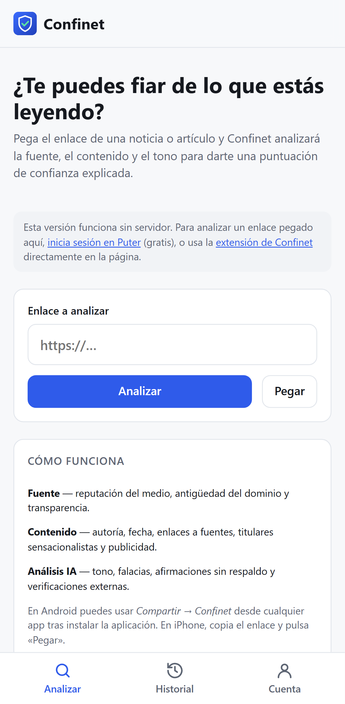
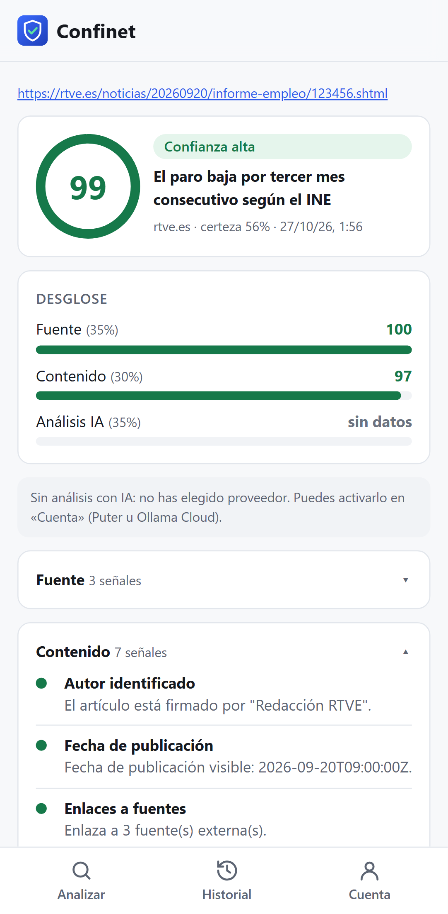
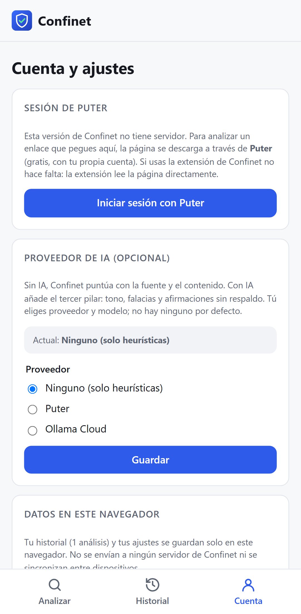
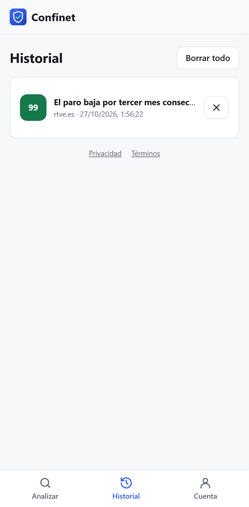

# Confinet user guide

🇪🇸 [Leer en español](guia-de-uso.md)

This guide explains, step by step, how to use Confinet to find out how much you can trust what
you read on the internet.

**Contents**

1. [What Confinet is (and isn't)](#1-what-confinet-is-and-isnt)
2. [Install the app](#2-install-the-app)
3. [Install the extension](#3-install-the-extension)
4. [Analyze a page](#4-analyze-a-page)
5. [Understand the result](#5-understand-the-result)
6. [Turn on AI analysis (optional)](#6-turn-on-ai-analysis-optional)
7. [History](#7-history)
8. [Automatic analysis in the extension](#8-automatic-analysis-in-the-extension)
9. [Report a wrong score](#9-report-a-wrong-score)
10. [Privacy: what leaves your browser](#10-privacy-what-leaves-your-browser)
11. [FAQ and troubleshooting](#11-faq-and-troubleshooting)
12. [For developers](#12-for-developers)

---

## 1. What Confinet is (and isn't)

Confinet analyzes a news story or article and gives you a **trust score from 0 to 100**,
explained signal by signal: who publishes it, how it is written and, if you turn it on, what an
AI model thinks about its tone and arguments.

- ✅ It is a **guide** to help you read critically.
- ✅ It tells you **why** it gives each score, so you can judge for yourself.
- ❌ **It is not a fact-checker**: it does not say whether something is true or false.
- ❌ It does not judge opinions or ideologies: it rates the method (sources, authorship, tone),
  not the stance.

There are two ways to use it, and they complement each other:

|          | **App (PWA)**                            | **Browser extension**                   |
| -------- | ---------------------------------------- | --------------------------------------- |
| Where    | Phone and desktop                        | Chrome, Edge, Brave (desktop)           |
| How      | You paste or share a link                | You click the icon on the page you read |
| Requires | A Puter session to download pasted links | Nothing else                            |

**Language**: Confinet is available in English and Spanish. It uses your browser's language by
default; you can change it in **Account → Language**, with the **EN · ES** links at the bottom of
the app, or in the extension options. The AI writes its summary in the same language.

---

## 2. Install the app

The app is a **PWA**: a website that installs like an app, without going through a store.

Open **<https://ahiram1701.github.io/confinet/>** and:

- **Android (Chrome)**: menu ⋮ → **"Install app"** (or "Add to Home screen"). **Confinet** will
  then appear in the **Share** menu of any app.
- **iPhone / iPad (Safari)**: **Share** button → **"Add to Home Screen"**.
- **Computer (Chrome / Edge)**: install icon ⊕ in the address bar.

 

> You don't have to install it: it also works in a normal browser tab.

---

## 3. Install the extension

The extension analyzes the page you have open with one click, and it is the most convenient way
on a computer.

### Microsoft Edge

Install it from **[Edge Add-ons](https://microsoftedge.microsoft.com/addons/detail/confinet-%E2%80%94-%C2%BFte-puedes-fia/nklniknidhkjnlibadmhchdbakdikhmf)**
and click **"Get"**: that way it updates itself. If you had already installed it manually from
the `.zip`, remove that copy in `edge://extensions` so you don't have two.

### Chrome and Brave (manual install, free)

1. Go to the [Releases](https://github.com/ahiram1701/confinet/releases) page and download the
   **`confinet-extension-X.Y.Z-chrome.zip`** file of the latest version.
2. Unzip it into a folder you won't delete.
3. Open `chrome://extensions` (in Brave, `brave://extensions`).
4. Turn on **"Developer mode"** (top right).
5. Click **"Load unpacked"** and choose the folder from step 2.
6. Click the puzzle piece icon 🧩 and **pin** Confinet to keep it at hand.

**Permissions it asks for**: read the active tab **only when you click its icon** (`activeTab`),
save your settings and check once a day for a new version (`alarms`). It does not read your
browsing history.

### Updates

| Where you use it                    | How it updates                                                                                                                                       |
| ----------------------------------- | ---------------------------------------------------------------------------------------------------------------------------------------------------- |
| App (website or installed PWA)      | **Automatically.** It checks for a new version every hour and when you return to the app; if there is one, it reloads with it.                       |
| Extension from Edge Add-ons         | **Automatically**, like any store extension.                                                                                                         |
| Extension installed from the `.zip` | Browsers don't update unpacked extensions. Confinet **lets you know** in its window: "A new version of Confinet is available…" with a download link. |

To update the unpacked extension:

1. Click **"Download"** in the notice (or go to
   [Releases](https://github.com/ahiram1701/confinet/releases/latest)) and get the `.zip`.
2. Unzip it **over the same folder** you used when installing it (replacing the files).
3. In `chrome://extensions`, click **↻** on the Confinet card.

Your settings are kept.

---

## 4. Analyze a page

### With the extension (recommended on a computer)

1. Open the news story or article.
2. Click the **Confinet** icon. You'll instantly see a **quick estimate** (source and content),
   and the icon will show the score, for example `~72`. The tilde means it is provisional.
3. Click **"Full analysis in Confinet"**. The app opens with the page already read, and adds the
   outlet reputation, the domain age and, if you turned them on, AI and fact-checks.

> The page travels inside the link itself (after the `#`), which browsers never send to any
> server.

### With the app: pasting a link

1. Copy the link to the story.
2. In the app, tap **"Paste"** (or paste it into the **"Link to analyze"** field) and then
   **"Analyze"**.

Because this version of Confinet has no server, it needs you to **sign in to Puter** (free) to
download pages from other sites. Go to **Account → "Sign in with Puter"**. If you don't want to
use Puter, use the extension.

### With "Share" (Android)

With the app installed, in any app (browser, X, Telegram…) tap **Share → Confinet**. The analysis
starts by itself. Confinet finds the link even if it comes inside some text ("Look at this:
https://…").

### iPhone

iOS doesn't let web apps appear in **Share**: copy the link and use **"Paste"**.

---

## 5. Understand the result

 

### The score and the level

| Score  | Level                  | What it means                                                |
| ------ | ---------------------- | ------------------------------------------------------------ |
| 70–100 | 🟢 **High trust**      | Good practices: authorship, sources, reliable outlet.        |
| 45–69  | 🟠 **Medium trust**    | Some weak signals: read it with caution.                     |
| 0–44   | 🔴 **Low trust**       | Several warning signs: check before you believe or share it. |
| –      | ⚪ **Not enough data** | Too little could be measured to give an honest score.        |

### Certainty

Next to the domain you'll see **"N% certainty"**: how much of all the possible signals could be
measured. A score of 90 with 40% certainty is worth less than a 75 with 90% certainty. If
certainty drops below 25%, Confinet gives no score.

### The three pillars

| Pillar          | Weight | What it looks at                                                                                                      |
| --------------- | ------ | --------------------------------------------------------------------------------------------------------------------- |
| **Source**      | 35%    | Outlet reputation, domain age, HTTPS, "About us" and "Contact" pages.                                                 |
| **Content**     | 30%    | Author, date, links to external sources, sensationalist headline, capitals and exclamation marks, ads, length.        |
| **AI analysis** | 35%    | Tone, fallacies, verifiable claims with or without a source, overall assessment, fact-checks. Only if you turn it on. |

If a pillar is missing (for example, AI), its weight is shared among the others and certainty
goes down.

### The signals

Expand each pillar to see its signals. Each one has a colored dot (🟢 good, 🟠 fair, 🔴 bad) and
an explanation. Some examples:

- **Links to sources**: "Links to 3 external sources", with the list of cited domains.
- **Sensationalist headline**: shows the formula detected (e.g. "YOU WON'T BELIEVE").
- **Outlet reputation**: says where the rating comes from. It can be Confinet's own list
  ("Semilla Confinet") or the list of sources rated by English Wikipedia editors ("Wikipedia
  (Perennial sources)", with hundreds of outlets, mostly international). If an outlet is in
  neither, the signal is not measured.
- **Fallacies detected** (AI): quotes the exact passage where each one appears.

### Notices that cap the score

A red ⚠ box means a cap. For example, if the outlet is flagged as **unreliable**, the score cannot
go above 45, however well written the article is; and if a fact-checker has **debunked** one of
its claims, it cannot go above 35.

---

## 6. Turn on AI analysis (optional)

Confinet **has no AI provider or model turned on by default**: you decide whether to use AI and
which one. Go to **Account → "AI provider (optional)"**.

 

### Option A: Puter (free)

[Puter](https://puter.com) offers Claude, GPT, Gemini and other models. Each person uses their
own Puter account, at no cost to Confinet.

1. In **"Puter session"**, click **"Sign in with Puter"** and create an account or sign in (a
   pop-up window opens).
2. Under **"Provider"**, choose **Puter**.
3. Click **"Load available models"** and pick one under **"Model"** (for example, a Claude model).
4. Click **"Save"**.

### Option B: Ollama Cloud (with your API key, paid)

[Ollama Cloud](https://ollama.com) offers open models in the cloud (gpt-oss, DeepSeek, Qwen,
GLM…). It **charges per token** to your Ollama account and does not include Claude models.

1. Create a key at **<https://ollama.com/settings/keys>** and add credit or a plan at
   <https://ollama.com/pricing>.
2. Under **"Provider"**, choose **Ollama Cloud** and paste the key into **"Ollama API key"**.
3. Click **"Load available models"** and choose a **model**.
4. Click **"Save"**.

The key is stored **only in this browser** and is kept even if you switch to Puter or "None":
when you go back to Ollama Cloud you don't need to paste it again (Confinet also remembers the
last model of each provider). To delete it, click **"Forget key"**.

Each AI analysis is a request to Ollama, billed according to the model and the article length
(up to about 6,000–8,000 input tokens). Large models such as `gpt-oss:120b` work well. If a model
does not follow the requested format, Confinet repeats the request once asking for the JSON in
the message itself (so it may cost two requests).

### Turn AI off

Choose **"None (heuristics only)"** and click **"Save"**. The Ollama key stays saved until you
click **"Forget key"**.

### External fact-checks (optional)

Confinet can look up the story's claims in fact-checks published by outlets such as Maldita,
Newtral, AFP or PolitiFact, through **Google Fact Check**. If you use AI, it searches the claims
the AI extracts; otherwise, the headline. A debunk appears under **"Related fact-checks"** and
caps the score at 35.

You need a free Google API key:

1. Go to [Google Cloud](https://console.cloud.google.com/apis/library/factchecktools.googleapis.com)
   (create a project if asked) and click **"Enable"** on **Fact Check Tools API**.
2. Under **APIs & Services → Credentials**, click **"Create credentials" → "API key"**. It's a
   good idea to restrict it to that API.
3. In Confinet, **Account → External fact-checks**, paste the key, click **"Test key"** and then
   **"Save"**.

The key is stored only in this browser. To remove it, click **"Forget key"**.

---

## 7. History

Under **History** you'll see your analyses, newest first, with their score.

 

- It is stored **only in this browser** (up to 200 analyses). It is not synced between devices.
- If you analyze the same link again, the previous result is replaced.
- Click **✕** to delete one, **"Delete all"** to empty it, or go to **Account → "Delete
  history"**.

---

## 8. Automatic analysis in the extension

In the extension **options** (right-click the icon → **Options**, or ⚙ in the Confinet window):

- **"Automatically analyze the articles I open (without AI)"**: shows the score on the icon when
  you open pages that look like articles, without clicking anything.
- When you turn it on, the browser will ask for permission to **read the websites you visit**.
  If you turn it off, Confinet removes that permission and goes back to acting only when you
  click its icon.
- Automatic analysis never uses AI.

---

## 9. Report a wrong score

Think a score is wrong? On the result, click **"Doesn't the score look right? Let us know on
GitHub"**. A pre-filled _issue_ opens with the link, the score and the signals: add what you
expected and why. You need a (free) GitHub account.

---

## 10. Privacy: what leaves your browser

| Action                     | What is sent                                  | To whom                     |
| -------------------------- | --------------------------------------------- | --------------------------- |
| Analyze with the extension | Nothing (the page is already in your browser) | —                           |
| Analyze a pasted link      | The URL                                       | Puter, to download the page |
| Domain age                 | The domain                                    | rdap.org (public service)   |
| AI with Puter              | Article title and text                        | Puter, with your account    |
| AI with Ollama Cloud       | Article title and text + your key             | Ollama                      |
| External fact-checks       | Claims or headline + your key                 | Google Fact Check Tools     |
| History and settings       | Nothing                                       | They stay in your browser   |

Confinet has no server of its own in this version, uses no third-party cookies or trackers, and
does not see your analyses. More details on the app's **Privacy** page.

---

## 11. FAQ and troubleshooting

#### "To analyze a link pasted here, sign in to Puter…"

For security reasons, websites can't read pages from other sites (CORS). Sign in to Puter in
**Account**, or use the extension.

#### The extension says "This page cannot be analyzed."

Browsers don't let extensions read internal pages (`chrome://`, `edge://`), extension stores or
PDF viewers.

#### The Puter sign-in window doesn't appear.

Your browser blocked the pop-up. Allow pop-ups for `ahiram1701.github.io` and click the button
again.

#### "Ollama rejected the API key (401)."

The key is wrong or was revoked. Create another one at ollama.com/settings/keys and save it again.

#### "Ollama did not accept the request (402/429)"

You have no credit or have exceeded the concurrent request limit. Check
ollama.com/settings/usage.

#### "The browser blocked the direct connection to Ollama…"

Ollama doesn't allow calls from this website. Sign in to Puter so the request goes through its
proxy (your key will travel through Puter).

#### "The model replied without JSON…" or "The model returned an empty response."

The model did not return the analysis in the expected format, not even after repeating the
request. Try another model (for example, `gpt-oss:120b`). If it keeps happening, open an issue
with the error text.

#### "The model's response was cut off before finishing."

The model ran out of response length (this often happens with models that "reason" a lot). Try
another model.

#### "Google rejected the key."

Check that you copied the key correctly and that **Fact Check Tools API** is enabled in the same
Google Cloud project. If you restricted the key, it must allow that API.

#### The result has no "Domain age".

The RDAP service doesn't always allow requests from the browser. With a Puter session, it is
looked up through Puter. If it still doesn't respond, that signal is simply not measured.

#### The score is "no data".

Very few signals could be measured (for example, a page with almost no text). Turn on AI or try
the full version of the article.

#### I changed phones and can't see my history.

History is stored only in the browser where you ran the analyses.

---

## 12. For developers

Want to run Confinet locally, deploy the version with a server (Cloudflare Workers, with accounts
and synced history) or contribute? See the [README](../README.md#desarrollo) and
[CONTRIBUTING.md](../CONTRIBUTING.md) (both in Spanish).
